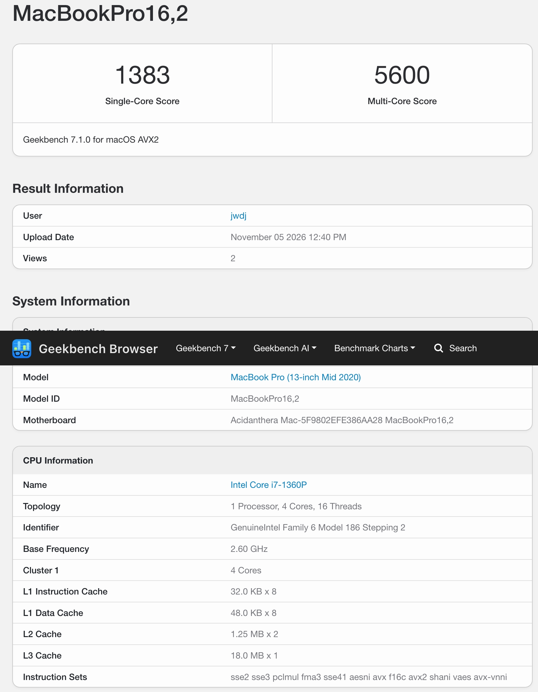
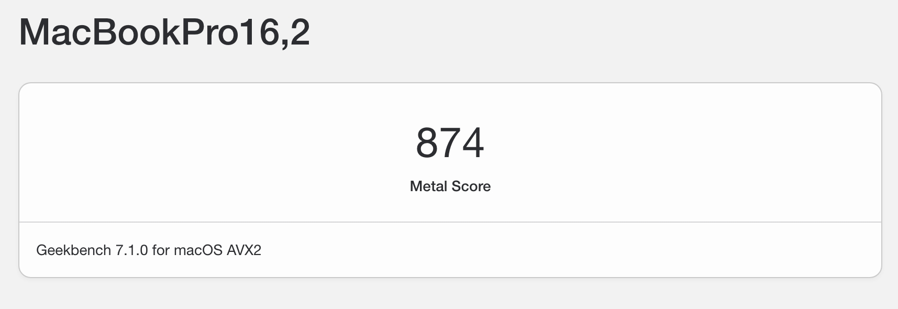

# HUAWEI YTG-XXX 擎云G540 Gen2 / i7-1360P / Iris Xe (8086:A7A0) — macOS Tahoe 26 + eDP 内屏加速

**状态：可正常启动，内屏 eDP 硬件加速已点亮（Metal 2），支持VDA硬解，无线有线网络均正常。触摸板、音频与电池仍不可用，见 [§7](#7-已知问题)。**





这份 EFI 是 华为擎云G540 Gen2-078 的**可复用快照**，不是通用配置——
序列号、ACPI、USB 映射都是针对这台机器的。

配套的补丁源码是对上游 WhateverXe 0.6.1 的 fork，改动在 `edp-panel-handoff` 分支：
[`attcai-cn/WhateverXe`](https://github.com/attcai-cn/WhateverXe/tree/edp-panel-handoff)
（上游：[b00t0x/WhateverXe](https://github.com/b00t0x/WhateverXe)）。

> ⚠️ **本仓库的 `EFI/OC/config.plist` 已抹除三码**（`SystemSerialNumber` / `MLB` /
> `SystemUUID` / `ROM` 全是占位值），直接拿来开机是**装不了机也登不了 iCloud** 的。
> 必须先按 [§2](#2-装机前必做换三码) 生成自己的三码。

---

## 1. 目标机器

| 项 | 值 |
| --- | --- |
| 机型 | HUAWEI YTG-XXX（擎云 G540 Gen2） |
| CPU | 13th Gen Intel Core i7-1360P（Raptor Lake-P，4P+8E / 12C16T，2.6 GHz） |
| 内存 | 16 GB |
| 核显 | Intel Iris Xe Graphics，`8086:A7A0`，rev `0x04` |
| 内屏 | **1920×1080 @ 60Hz eDP**，`Connection Type: Internal` |
| macOS | **26.7**（Tahoe） |
| SMBIOS | `MacBookPro16,2` |
| 无线 / 蓝牙 / 网卡 | Intel Wi-Fi（AirportItlwm 2.4.0）、Intel 蓝牙（IntelBluetoothFirmware 2.5.1）、YT6801 有线网卡 |

全部第三方 kext 的版本与来源见 [`docs/kexts.md`](docs/kexts.md)。

### 1.1 分辨率

内屏是 **1920×1080**，因此 `UEFI → Output → Resolution` 设为 `1920x1080`
（旧版这里留着 OpenCore 的默认值 `1024x768`，固件 GOP 起在这个模式上，
系统侧的帧缓冲会继承一个非原生模式，内屏就跑不到 1080p）。

```xml
<key>Resolution</key>
<string>1920x1080</string>
```

`ForceResolution` 保持 `false`：只在固件确实提供该模式时才切换，避免强行设置不存在的模式把开机画面搞黑。

---

## 2. 装机前必做：换三码

1. 用 OCAT 或 GenSMBIOS 生成一套 `MacBookPro16,2` 的三码。
2. 填进 `PlatformInfo → Generic`：`SystemSerialNumber`、`MLB`、`SystemUUID`、`ROM`。
   `ROM` 填本机有线网卡的 MAC（6 字节，十六进制）。
3. 首次开机在 OpenCore 菜单按 `空格` → `Reset NVRAM`，再进系统。

⚠️ 直接沿用别人的三码会导致 iCloud / iMessage / FaceTime 异常，也可能两台机器互踢账号。
本仓库里的占位值**仅供占位**，不具备任何有效性。

---

## 3. 验证结果

```
[3] DVMT     DVMTCalcFix.isApplied=1   calcReady=1   xelpMemory=60 MiB
[4] 后端      WEXFramebufferInstallation=(1,1,1,1)   8 个 hook 全 Yes
[5] 注册      N97SharedRegisterPrerequisites = Yes
[6b] handoff  N97FBBootHandoff STATUS=0(Complete)   StartAccepted=Yes
[7] 节点      AppleIntelFramebufferController / IntelFBClientControl / IntelAccelerator 均存在
[8] 显示      Metal 2 · 1920×1080 @60Hz · Connection Type: Internal · VRAM 1536 MB（动态）
```

完整日志：[`docs/after-patch-working.txt`](docs/after-patch-working.txt)
（[`docs/before-patch-notready.txt`](docs/before-patch-notready.txt) 是打补丁前的失败对照：
`STATUS=1 NotReady`、`StartAccepted=No`、`IntelAccelerator` 全系统 0 次出现）。

---

## 4. 这份 EFI 的关键点

### 4.1 `Kernel → Add` 顺序（不能乱）

```
Lilu → AppleALC → AMFIPass → WhateverXe → VirtualSMC → RestrictEvents
CpuTopologyRebuild → NVMeFix → XHCI-unsupported → ECEnabler
USBToolBox → UTBMap → BlueToolFixup → IntelBluetoothFirmware
IntelBTPatcher → VoodooI2C（含 3 个 PlugIn）→ VoodooI2CHID
VoodooPS2Controller（含 3 个 PlugIn）→ AirportItlwm
```

- `WhateverXe.kext` **必须**排在 `Lilu.kext` 之后（它是 Lilu 插件）。
- `VoodooPS2Controller` 内嵌的 `VoodooInput.kext` 是**关闭**的，避免与 VoodooI2C 的那份冲突。

### 4.2 boot-args

```
keepsyms=1 -vi2c-force-polling -v -allow3d -disablegfxfirmware -igfxdvmt itlwm_he=1 debug=0x100 alcid=15
```

| 参数 | 作用 | 备注 |
| --- | --- | --- |
| `-allow3d` | 允许加速器走 3D 路径 | 必需 |
| `-igfxdvmt` | **让 WEX 自己计算并覆盖 DVMT** | 本机算出 60 MiB；缺它帧缓冲后端装不上 |
| `-disablegfxfirmware` | 禁用核显固件加载，避免与 WEX 抢 GPU | 该平台必需 |
| `-vi2c-force-polling` | VoodooI2C 强制轮询 | 触控板稳定性 |
| `alcid=15` | AppleALC layout | 本快照下音频未确认，需按机型再调 |
| `itlwm_he=1` | AirportItlwm 走 11ax 路径 | — |
| `-v` `debug=0x100` `keepsyms=1` | 详细日志 | **调试用**，稳定后可删，能明显加快启动 |

### 4.3 `DeviceProperties → PciRoot(0x0)/Pci(0x2,0x0)`

| 键 | 值 | 说明 |
| --- | --- | --- |
| `built-in` | `00` | 标记内建显卡 |
| `framebuffer-patch-enable` | `01000000` | 打开帧缓冲补丁 |
| `framebuffer-stolenmem` | `00cc0000` | 12.75 MiB 预留 |
| `hda-gfx` | `onboard-1` | HDMI/DP 音频关联 |

真正的显存大小由 `-igfxdvmt` + WEX 的 `DVMTCalcFix` 决定（本机 60 MiB），
上面两项只是保证帧缓冲补丁链不被前置条件挡住。

### 4.4 ACPI / Drivers / 安全

- **ACPI**（7 个）：`SSDT-ALS0` `SSDT-EC` `SSDT-PLUG-ALT` `SSDT-PNLF` `SSDT-RTCAWAC`
  `SSDT-USB-Reset` `SSDT-USBX`
  ——注意**不含**电池（`SSDT-BATT` 一类），电池检测尚未修复，见 [§7.1](#71-电池待修复)
- **Drivers**：`HfsPlus.efi` `OpenRuntime.efi` `ResetNvramEntry.efi`
- **Security**：`SecureBootModel=Disabled`、`Vault=Optional`、`ScanPolicy=0`、
  `csr-active-config=0x803`（NVRAM 中存为 `03080000`，小端）
- **Booter**：`DevirtualiseMmio` `RebuildAppleMemoryMap` `SyncRuntimePermissions`
  `ProtectUefiServices` `FixupAppleEfiImages` 开

### 4.5 配套的系统侧组件

- **WhateverXe Graphics pkg**（≥ 0.3.2，来自
  [b00t0x/WhateverXe-Graphics](https://github.com/b00t0x/WhateverXe-Graphics/releases)）
  —— 提供加速器本体，装进 `/Library` 并更新 AuxKC。**没有它，WEX 再对也只有帧缓冲没有 Metal。**
- Lilu `1.7.3`、AMFIPass `1.4.1`、OpenCore 见 `EFI/OC/OpenCore.efi`

---

## 5. 怎么复用到别的机器

1. **换三码**：见 [§2](#2-装机前必做换三码)。
2. **换 USB 映射**：`UTBMap.kext` + `SSDT-USB-Reset` 是本机端口表，必须用 USBToolBox 重做。
3. **换触摸板**：`VoodooI2C` 的 pinning（GPIO pin / APIC pin）在
   `DeviceProperties` 或 SSDT 里，不同机型不一样。
4. **核显不同就别照抄**：本 EFI 的 DVMT 修正、eDP handoff 都是针对
   RPL-P + `A7A0` 调出来的。换 Alder Lake-N 或别的 DDI 布线要重新看
   `N97NativeBootConnector` / `WhateverXeFirmwarePanel`。

---

## 6. 目录

```
.
├── EFI/
│   ├── BOOT/BOOTx64.efi
│   └── OC/
│       ├── ACPI/        7 个 SSDT
│       ├── Drivers/     HfsPlus / OpenRuntime / ResetNvramEntry
│       ├── Kexts/       19 个 kext（含补丁版 WhateverXe 0.6.1）
│       ├── Resources/   字体与图标
│       ├── OpenCore.efi
│       └── config.plist           ← 三码已抹除
├── docs/
│   ├── after-patch-working.txt    ← 点亮 Metal 2 的完整诊断输出
│   ├── before-patch-notready.txt  ← 补丁前失败对照
│   └── kexts.md                   ← 第三方 kext 版本与来源
├── SHA256SUMS.txt
└── README.md
```

`WhateverXe.kext` 的 sha256：
`ceb8bc2f7e4245ec75d51cbd920ab21597f1c0266a228270c12a9ee5047effd6`
—— 与补丁仓库 `dist/WhateverXe.kext` 是同一份。

---

## 7. 已知问题

| 项 | 状态 |
| --- | --- |
| **音频** | 不可用。`AppleALC` 已注入（`alcid=15`），但 `system_profiler` 未列出音频设备，需单独确认 codec 与 layout |
| **电池** | **检测不到，待修复 ACPI**。详见 [§7.1](#71-电池待修复)，缺电池 ACPI 补丁与 `SMCBatteryManager.kext` 两样 |
| **睡眠 / 唤醒** | 未做专项验证 |
| **外接显示** | 只验证内屏 eDP；HDMI/DP 走上游严格 SST 路径，未测 |
| **1920×1080 模式** | `Output → Resolution` 已改为 `1920x1080`，待复测确认（见 [§1.1](#11-分辨率)） |
| **`-v` / `debug=0x100`** | 仅调试方便，长期使用建议去掉 |

### 7.1 电池（待修复）

**现象**：菜单栏没有电池图标，`pmset -g batt` 只显示外接电源，
`ioreg -rn AppleSmartBattery` 取不到对象。

**缺两样东西，修 ACPI 只是其中一半**：

1. **电池 ACPI 补丁**（`SSDT-BATT` 一类）——本机 ACPI 里只有
   `SSDT-ALS0` `SSDT-EC` `SSDT-PLUG-ALT` `SSDT-PNLF` `SSDT-RTCAWAC`
   `SSDT-USB-Reset` `SSDT-USBX` 这 7 个，**没有**任何电池相关 SSDT。
   华为这类机器的 EC 电池字段通常是 16-bit 分高位/低位存放，
   需要按 DSDT 里的实际布局拆字段（`B1B2` / `RBEC` 辅助方法），
   并把 `_BST` / `_BIF`（或 `_BIX`）挂到新建的 `BAT0` 设备上。
2. **`SMCBatteryManager.kext`** —— 本 EFI 的 `VirtualSMC.kext` 是精简运行时包
   （没有 `Contents/PlugIns` 目录），没有带电池插件。
   这一环缺着，**ACPI 修得再对也不会有电池图标**，因为系统侧根本没有
   产生 `AppleSmartBattery` 的驱动。

**已启用但不解决问题的部分**：`ECEnabler.kext` 只负责读取 >8bit 的 EC 字段，
它不生成电池设备，也无法替代上面的 `SSDT-BATT`。

**下一步**：dump 本机 DSDT/EC 后确认电池设备的真实路径（`H_EC` / `EC0` / `BAT0` 命名各家不同），
做字段拆分 + rename 补丁；同时把 `SMCBatteryManager.kext` 加进
`Kernel → Add`（排在 `VirtualSMC` 之后）。修完复测：

```bash
pmset -g batt
ioreg -rn AppleSmartBattery | grep -E "CycleCount|DesignCapacity|CurrentCapacity"
```

---

## 8. 致谢与许可

本 EFI 不含任何原创内核代码，只是一个组装好的引导配置库：

- **OpenCore** / **Lilu** / **VirtualSMC** / **AppleALC** / **RestrictEvents** /
  **NVMeFix** / **VoodooPS2Controller** / **BlueToolFixup** — [Acidanthera](https://github.com/acidanthera)（BSD-3-Clause）
- **WhateverXe** — [b00t0x](https://github.com/b00t0x/WhateverXe)（BSD 风格，见其 `LICENSE.txt`）
- **VoodooI2C / VoodooI2CHID** — [alexandred](https://github.com/VoodooI2C)（GPL-2.1）
- **AirportItlwm / IntelBluetoothFirmware / IntelBTPatcher** — [zxystd](https://github.com/OpenIntelWireless)（GPL-2.0）
- **AMFIPass** — dhinakg；**ECEnabler** — 1Revenger1；**XHCI-unsupported** — RehabMan；
  **CpuTopologyRebuild** — b00t0x；**USBToolBox / UTBMap** — dhinakg

各 kext 的许可证随其 `Contents/Info.plist` 与官方仓库一同生效，二次分发请保留原始
bundle 与版权信息。SSDT 与 `config.plist` 的整理部分可视为 **CC0 / 公有领域**。

---
